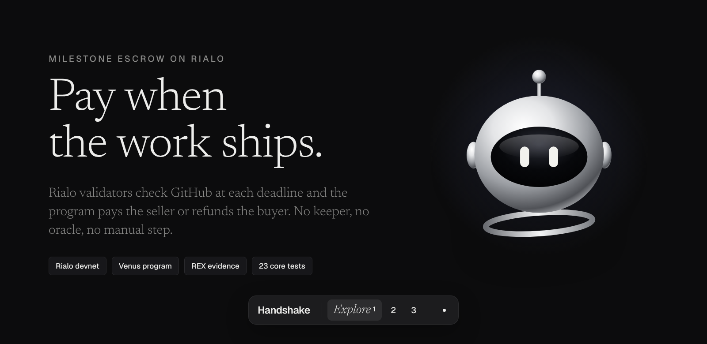
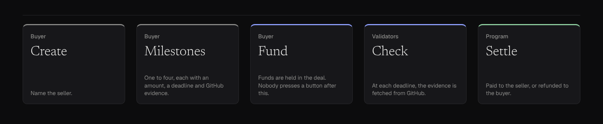
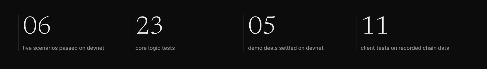
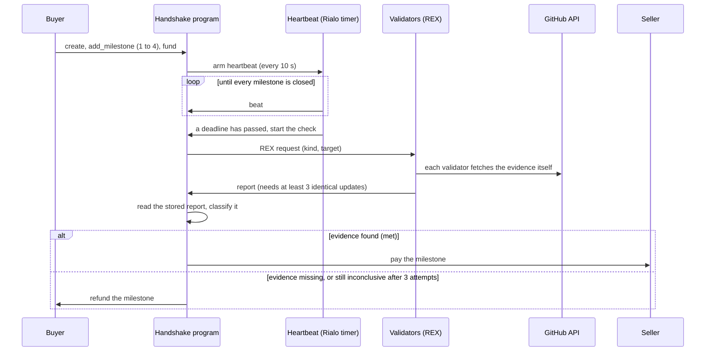
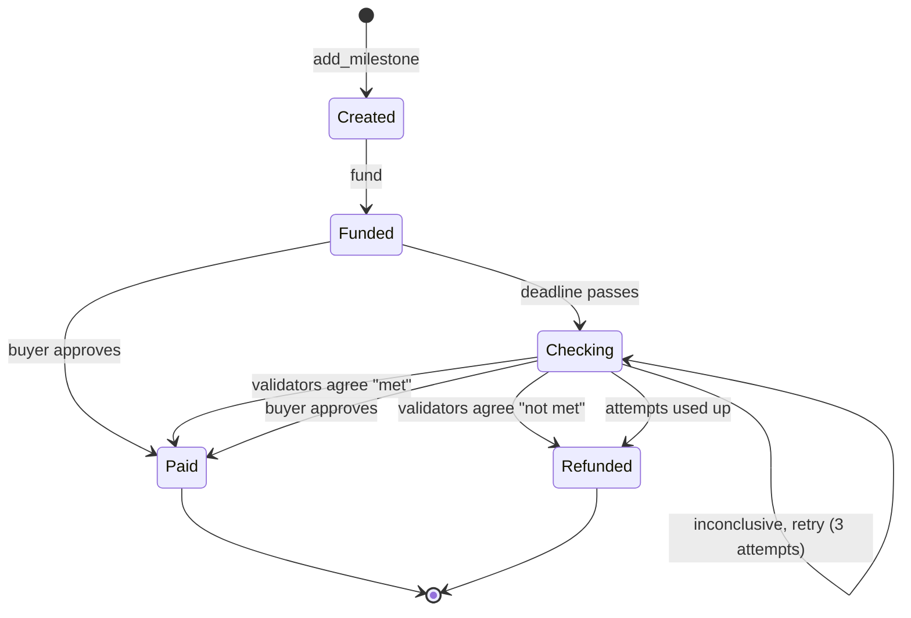

<div align="center">

<picture>
  <source media="(prefers-color-scheme: light)" srcset="assets/banner-light.png">
  
</picture>

<p>
  <a href="https://handshake-xyz.vercel.app"><b>Open the app</b></a> &nbsp;·&nbsp;
  <a href="docs/EVIDENCE.md">Evidence</a> &nbsp;·&nbsp;
  <a href="docs/THREAT_MODEL.md">Threat model</a> &nbsp;·&nbsp;
  <a href="SECURITY.md">Security</a>
</p>

<p>
  <a href="https://github.com/Siriron/handshake-rialo/actions/workflows/ci.yml"></a>
  <a href="https://github.com/Siriron/handshake-rialo/actions/workflows/web-ci.yml"></a>
  <a href="LICENSE"></a>
  
  
</p>

</div>

**Milestone payments that complete themselves.** A buyer locks funds against up to four milestones. When a milestone's deadline passes, the Rialo network itself checks real-world evidence on GitHub and then pays the seller or refunds the buyer. After funding, nobody has to press a button: no keeper, no oracle, no manual step.

<picture>
  <source media="(prefers-color-scheme: light)" srcset="assets/flow-light.png">
  
</picture>

<picture>
  <source media="(prefers-color-scheme: light)" srcset="assets/stats-light.png">
  
</picture>

> **Status: devnet.** The on-chain program, its verifiers and the web app are deployed and exercised on Rialo devnet (see [Evidence](#evidence)). It has not had an external security review and must not hold real value.

---

## Contents

1. [The problem](#the-problem)
2. [How it works](#how-it-works)
3. [Verifiers](#verifiers)
4. [Why this needs Rialo](#why-this-needs-rialo)
5. [Using a deal](#using-a-deal)
   - [The web app](#the-web-app)
6. [Rules and limits](#rules-and-limits)
7. [Money flow and costs](#money-flow-and-costs)
8. [Security model](#security-model)
9. [Evidence](#evidence)
10. [Architecture and repository layout](#architecture-and-repository-layout)
11. [Build, test, deploy](#build-test-deploy)
12. [Design decisions and what testing taught us](#design-decisions-and-what-testing-taught-us)
13. [Known limitations](#known-limitations)
14. [Deployed addresses](#deployed-addresses)
15. [Security policy, license, acknowledgements](#security-policy-license-acknowledgements)

---

## The problem

Paying for work in stages is simple to describe and awkward to enforce. Whoever holds the money has to be trusted to release it, or a third party has to judge whether the work was done, or an oracle service has to report a fact onto the chain. Each of those adds a party that can be wrong, slow, bribed or switched off.

Handshake removes them for the common case where "the work is done" can be shown by a public fact: a software release was published, or a pull request was merged. The facts are read by the network's own validators, and the money rules are enforced by a program that neither party controls.

## How it works

1. **Create.** The buyer creates a deal naming the seller's address.
2. **Add milestones.** The buyer adds one to four milestones. Each has an amount, a deadline, and a piece of public evidence to look for (a release tag or a pull request).
3. **Fund.** The buyer locks the total in the deal's escrow account. This is the last action either party must take.
4. **Wait.** A heartbeat built on Rialo's native timers wakes the deal every 10 seconds. When a milestone's deadline passes, the program asks the validators to check the evidence.
5. **Settle.** If at least three validators independently return the identical answer, the program acts on it: evidence found pays the seller, evidence missing refunds the buyer. Any other outcome is retried, and after three attempts the milestone is refunded.

The buyer may also **approve** a milestone early, which pays the seller without waiting for the deadline.



Each milestone moves through a small state machine and ends exactly once:



## Verifiers

A milestone names its evidence with a **kind** and a **target**. Both are fixed when the milestone is added and cannot be changed afterwards.

| kind | target format | counts as met when | counts as not met when |
| --- | --- | --- | --- |
| `1` GitHub release | `owner/repo@tag` | a published, non-draft release with that tag exists (pre-releases count) | the release does not exist |
| `2` GitHub pull request | `owner/repo#number` | the pull request is merged | the pull request is open, or closed without merging |

Targets are strictly validated: ASCII letters, digits, `-`, `_` and `.` only, no leading dot, no `..`, bounded lengths, no leading zeros in PR numbers. Anything else is rejected when the milestone is added.

**What "met" proves, and what it does not.** A verified milestone means the evidence *exists* on GitHub as the validators saw it. It does not mean the work is good. Whoever controls the evidence controls the answer: for a release, whoever can publish releases in that repository; for a pull request, whoever can merge into it. A buyer who wants a pull-request milestone to mean something should point it at a repository the buyer's own side controls. A seller should read the target before accepting a deal, because the buyer chooses it. See the [threat model](docs/THREAT_MODEL.md).

What each validator reports is a short, deterministic string, so honest validators agree byte for byte:

```
HS1|<kind>|<target>|<state>
```

where `<state>` is `released` or `absent` (kind 1), or `merged`, `open` or `closed` (kind 2). A failed request is reported as `http-<status>` and counts as inconclusive.

## Why this needs Rialo

Handshake uses three things that Rialo provides natively. On a chain without them, each would be a separate service to run and trust.

- **REX (Rialo's native web requests).** Validators themselves fetch the GitHub evidence inside the network and agree on the result. There is no oracle operator, and no bridge between a web service and the chain.
- **Native timers and subscriptions.** The program arms its own timers (`AFTER ...`), so deadlines are enforced by the network rather than by a keeper bot that someone has to run and pay.
- **Venus.** Rialo's workflow language and toolchain, which generates the on-chain program, its client interface and the validator-side REX component from one source.

## Using a deal

Calls go through the Rialo CLI. Every call names the deal by a random 32-byte hex **slug** and is signed by a CLI account alias. The deal lives in an account derived from the buyer's key and the slug, so only the buyer can address it.

```bash
SLUG=$(openssl rand -hex 32)
call() {  # call <function> <args...>
  rialo -n devnet -a buyer client program invoke "$PROGRAM" --program-dir program \
    --function "$@" --arg workflow_pda_slug="$SLUG"
}

# 1. create the deal (the only call that needs the REX component address)
rialo -n devnet -a buyer client program invoke "$PROGRAM" --program-dir program \
  --function create --rex-bytecode-account "$REX" \
  --arg workflow_pda_slug="$SLUG" --arg payee="$SELLER"

# 2. add up to four milestones; deadlines are absolute Unix milliseconds
call add_milestone --arg amount_kelvin=50000000 --arg deadline_ms=$D1 \
     --arg kind=2 --arg target='owner/repo#42'
call add_milestone --arg amount_kelvin=50000000 --arg deadline_ms=$D2 \
     --arg kind=1 --arg target='owner/repo@v1.0.0'

# 3. fund: locks the sum of all milestones and starts the heartbeat
call fund

# optional: pay a milestone early (index starts at 0)
call approve --arg index=0
```

| call | who | does |
| --- | --- | --- |
| `create(payee)` | buyer | creates the deal; refuses a payee equal to the buyer, the escrow account, the program, or the zero address |
| `add_milestone(amount_kelvin, deadline_ms, kind, target)` | buyer | adds the next milestone before funding; validates everything in [Rules and limits](#rules-and-limits) |
| `fund()` | buyer | locks the sum of all milestones; refused if the first deadline has already passed |
| `approve(index)` | buyer | records approval; the heartbeat pays the milestone on its next tick |

Everything else (the heartbeat, the checks, the settlement) is internal and runs from timers and validator reports. The Rialo CLI does not expose those internal handlers, so they cannot be invoked from it.

> **CLI note.** `rialo client program invoke` only *submits* a transaction. Wait for each call to land before sending the next one that depends on it; the repository's test workflow does this by polling `rialo client transaction <signature>` for a status.

## The web app

The `web/` folder holds the app: a sphere of cards to explore, a grid of deals where you create, open and approve them, and a proof page. It runs on Rialo devnet, in day or night mode.

- **Create a deal in a minute.** The New deal form has a "Load demo deal" menu with five presets (release ships, PR never merged, two milestones delivered, mixed outcome, approve early). Each preset was run on devnet through the same code the form uses and ended as described. A deal costs about 0.024 RLO beyond the milestone amounts.
- **Throwaway wallet.** The app makes a devnet account in your browser and lets you keep several and switch between them without a page reload. It is for test funds only and is not a place for real value.
- **How it talks to the chain.** The devnet RPC sends no CORS headers, so the app calls a small same-origin relay (`web/api/rpc.ts`) that forwards only read and send methods. Deal addresses, instruction bytes and the account layout are derived in `web/src/lib/rialo/` and checked by tests against transactions and accounts recorded from devnet.
- **Deploy.** Import the repository in Vercel and set Root Directory to `web`. Optional environment variable: `RIALO_RPC`.

```bash
cd web && npm ci
npm run dev       # proxies /api/rpc to devnet
npm test          # client logic against recorded devnet data
npm run build
```

## Rules and limits

| rule | value | why |
| --- | --- | --- |
| milestones per deal | 1 to 4 | state is fixed-width, so account size never changes |
| minimum amount | 10,000,000 kelvin (0.01 RLO) | paying a brand-new account less than the rent-exempt minimum fails at the runtime; dust is refused up front |
| deadline when a milestone is added | between 60 seconds and 24 hours ahead | bounds the cost and length of the heartbeat |
| spacing between deadlines | at least 30 seconds | verification windows never overlap |
| order | deadlines strictly increasing | milestones are processed one at a time, oldest first |
| fund | first deadline must still be ahead | a stale deal cannot be funded into an instant check |
| validator updates per report | at least 3 identical | one dissenting or failed validator blocks the report |
| check attempts per milestone | 3 | then the milestone is refunded |
| time before a silent check is rescued | 45 seconds | covers a report that never arrives |
| heartbeat | every 10 seconds | DevNet timers expire after about 15 seconds |

**Worst case when validators never report at all:** a milestone is refunded about 200 seconds after its deadline, and each further milestone adds about 190 seconds. This is computed by a simulation test that uses the real decision functions, including the case where the check itself fails every time.

1 RLO is 1,000,000,000 kelvin.

## Money flow and costs

- Funds move only between the buyer and the seller. There is no fee, no interest, no yield, no token, and no leverage or speculation of any kind.
- The buyer deposits the sum of all milestones into the deal's escrow account. Each milestone then ends exactly once, as a payment to the seller or a refund to the buyer.
- Network costs fall on the buyer as the deal's payer: REX requests and account rent. On devnet a two-milestone deal cost roughly 0.03 RLO in fees and rent on top of the principal. Failed transactions cost nothing.
- The escrow account keeps its rent-exempt minimum after the deal closes.

## Security model

The adversary that matters is the **buyer**, who can sign any instruction against their own deal and would like to avoid paying. A seller cannot touch the deal at all: it lives in an account derived from the buyer's key, so a seller's call addresses a different, non-existent account and fails.

Defences, each described and mapped to tests or devnet evidence in [`docs/THREAT_MODEL.md`](docs/THREAT_MODEL.md):

- **The verdict is computed from the report stored in the on-chain report account**, never from an argument a caller supplies. The account must be the exact one recorded when the request was armed, owned by the REX processor, and created by the buyer.
- **Unanimity is strict.** Every raw update must be a successful, byte-identical payload for exactly this milestone's kind and target. Anything else, including HTTP errors and malformed or oversized payloads, is inconclusive.
- **Inconclusive never pays.** After three attempts an inconclusive milestone is refunded, so a broken data source can cost an honest seller a payment but can never move money to the wrong party.
- **Every milestone settles exactly once.** Settlement only acts on an open milestone and marks it; a repeated or late call does nothing. The accounting is property-tested: paid plus refunded plus remaining always equals what was funded.
- **A stalled check cannot lock funds.** Attempts are counted when armed, so even a check that keeps failing (for example because the buyer drained the wallet that pays for REX) runs out of attempts and refunds. A timeout rescues a check whose report never arrives.
- **The verifier is pinned.** The REX component's address is fixed in the program, so a deal cannot be wired to a look-alike verifier.

This repository has **not** been externally audited.

## Evidence

Everything below is on Rialo devnet and is documented with transaction signatures and program logs in [`docs/EVIDENCE.md`](docs/EVIDENCE.md).

| exercised on devnet | result |
| --- | --- |
| release verifier | a published release paid the seller; a missing tag refunded the buyer |
| pull-request verifier | a merged PR paid the seller; a closed-unmerged PR refunded the buyer |
| early approval | the seller was paid within about 10 seconds of `approve` |
| four deals running at once from one buyer | all settled correctly |
| a seller trying to approve the buyer's deal | failed on chain with no effect |
| a buyer re-creating a funded deal to reset it | failed on chain with no effect |
| a deal after those attacks | still settled exactly once |

The evidence file also lists what testing found and fixed, and what has **not** been verified on chain.

## Architecture and repository layout

```
handshake-rialo/
├── core/                  pure decision logic, no chain types, 23 tests
│   └── src/{lib.rs,tests.rs}
├── program/               the Venus program and its REX verifier
│   ├── src/lib.rs
│   └── artifact/          builds the deployable PolkaVM binary and REX component
├── docs/
│   ├── THREAT_MODEL.md    trust assumptions, attacks considered, known gaps
│   └── EVIDENCE.md        devnet signatures, logs, defects found, unverified paths
├── web/                   the app (Vite, TypeScript, Three.js) and its devnet test scripts
│   ├── src/lib/rialo/     deal address, instruction bytes, account decoder
│   └── api/rpc.ts         same-origin relay to the devnet RPC
├── assets/                images used by this README
├── .github/workflows/     ci, web-ci, deploy-devnet, test-scenarios, web-e2e, web-presets
├── rust-toolchain.toml    pins Rust 1.90.0 (see Build, test, deploy)
├── SECURITY.md
└── LICENSE
```

**Why two crates.** Every decision that moves money lives in `core`: target validation, report classification, settlement accounting, scheduling and the retry and timeout policy. `core` has no dependency on Rialo, so its 23 tests run in milliseconds on any machine and include an exhaustive classifier suite, a 2,000-sequence conservation property test, and a simulation of the heartbeat under failure. `program` is deliberately thin: it wires those decisions to accounts, timers and validator reports.

## Build, test, deploy

**Run the tests** (no Rialo toolchain needed):

```bash
cargo test   --manifest-path core/Cargo.toml
cargo clippy --manifest-path core/Cargo.toml --all-targets -- -D warnings
cargo fmt    --manifest-path core/Cargo.toml --check
cargo check  --manifest-path program/Cargo.toml
```

**Toolchain pin (important).** `rust-toolchain.toml` pins Rust 1.90.0. The REX verifier compiles to a WASI component whose imports depend on the Rust version, and a component built with current stable (1.100, WASI 0.2.12) fails to instantiate on DevNet validators, which turns every check inconclusive. Do not bump the pin without a live devnet check.

**Continuous integration** (`ci.yml`) runs format, clippy with warnings as errors, the core tests and a type-check of the program on every push, using pinned third-party actions.

**Deploy and live tests** run from a Linux GitHub runner with the Rialo 0.18.1 toolchain (installed with `rialoman`):

- `deploy-devnet` builds the artifact and deploys it with persistent keys held as repository secrets (`HS_DEPLOYER_KEYPAIR`, `HS_PROGRAM_KEYPAIR`, `HS_REX_KEYPAIR`). It verifies the keys load to the pinned addresses and fails loudly if the expected program and REX addresses are not reported.
- `test-scenarios` runs the live scenarios against the deployed program and fails the job if any assertion fails.
- `web-e2e` and `web-presets` run the web app's own code against devnet with throwaway keys and no secrets. The first creates, funds, approves, pays and refunds a deal; the second runs every demo preset and checks how it ends. `web-ci` type-checks, tests and builds the app on every push to `web/`.

Both are manual (`workflow_dispatch`), scope the keys to a single step, and run one at a time. The program and REX addresses are deterministic because the deploy passes fixed keypairs; the REX address is pinned in `program/src/lib.rs` as `AUTHORIZED_REX`.

## Design decisions and what testing taught us

- **GitHub evidence only.** An earlier version also had a free-form "status endpoint" verifier. It was removed: it needed a placeholder URL and could not be tested honestly, and a milestone that cannot be tested should not ship.
- **Inconclusive means refund.** The program prefers returning the buyer's money to guessing. The cost, an honest seller occasionally unpaid after a data-source failure, is stated openly rather than hidden.
- **Timers stay under 11 seconds.** A DevNet timestamp subscription expires after about 15 seconds, so the heartbeat re-arms every 10 seconds instead of scheduling far ahead.
- **`approve` only records state.** The first version armed a timer from the control call. All control calls run in "branch 0", so that timer used the same subscription address as the heartbeat and silently replaced it. Now `approve` sets a flag and the heartbeat, which runs in its own timer branches, pays it.
- **Verdict from the stored report.** An earlier version classified the report passed as an argument. It now parses the report account itself, so a forged argument cannot change a verdict.
- **Attempts are counted when armed.** Counting inside the check would let a check that keeps failing retry forever with funds locked. Counting at arming time, plus a separate count of attempts actually started, closes that and also stops a direct caller from running extra attempts.
- **Fixed-width state.** Milestones live in fixed arrays and targets are padded to a fixed width, so the escrow account never needs resizing.
- **The REX toolchain is part of the trust base.** The WASI mismatch above was found by testing, not by reading code; it is now documented and pinned.

## Known limitations

- **Devnet only.** Not audited, not for real value.
- **No disputes, arbiters, partial payouts, tokens or fees.**
- **Evidence is GitHub only,** and "met" proves existence, not quality.
- **Deals are short.** Windows are capped at 24 hours; longer deals are untested.
- **GitHub rate limits.** Unauthenticated GitHub API access is limited per source address (roughly 60 requests per hour). If validators share addresses, checks can come back inconclusive, which refunds the buyer.
- **Heartbeat liveness is assumed.** If a timer transaction ever failed outright, a deal would stall with its funds locked. None has been observed.
- **Not yet exercised on devnet:** a hand-built transaction calling an internal handler directly (the CLI cannot make one), a forged report argument sent on chain, the stuck-check rescue, and a check pipeline that fails every time. The decision logic for the last two is covered by the simulation test. These are listed in [`docs/EVIDENCE.md`](docs/EVIDENCE.md).
- **Web app:** devnet only, with a throwaway browser wallet. Its chain code and every demo preset were exercised on devnet by test scripts; the deployed page's buttons were not driven end to end by an automated browser test.

## Deployed addresses

Rialo devnet:

| | address |
| --- | --- |
| program | `5umz6vh9vQ85fJhYrUmDMm6pGYVj5Cr5Tv9RS9GfEf2h` |
| REX verifier | `7pycwurxgfQMaTN9KMbHqn8vCcBzgZhJKvB4epLyjpH3` |

Inspect any transaction with `rialo -n devnet client transaction <signature>`.

## Security policy, license, acknowledgements

- **Reporting a vulnerability:** see [`SECURITY.md`](SECURITY.md).
- **License:** [Apache-2.0](LICENSE).
- **Acknowledgements:** built on Rialo and its Venus toolchain by Subzero Labs. Patterns for report binding, fixed-width state and DevNet timer behaviour were informed by the public devnet evidence in Merit (`kenil1710/merit`), which is a different project.
